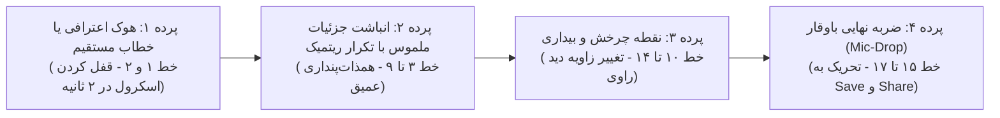

# سند جامع پرسونا، DNA محتوایی و چارچوب وایرال پیج (RozeText Blueprint v2.0)

این سند حاصل کالبدشکافی آماری، زبانی و روانشناختی **۲۹۲ ریلز** منتشرشده در پیج شما است که شامل **۲۳۳ ریلز پایه** (در [final-report.md](file:///d:/rozetext-framework/final-report.md)) به علاوه **۵۲ ریلز تست میدانی در مهر ۱۴۰۵** (در [06-10-2026-report.md](file:///d:/rozetext-framework/06-10-2026-report.md)) می‌باشد:
* **مجموع بازدید ۵۲ ریلز اخیر:** **۹,۲۱۳,۰۲۶ بازدید** (میانگین ۱۷۷,۱۷۴ ویو به ازای هر ریلز)
* **تعاملات ارگانیک ۵۲ ریلز اخیر:** **۱۴۱,۲۴۷ اشتراک‌گذاری دایرکت**، **۷۳,۲۳۰ سیو** و **+۵,۲۴۷ فالوور جدید**
* **نرخ موفقیت بالای ۵۰K ویو در تست میدانی:** **۵۹.۶٪** (۳۱ ریلز از ۵۲ ریلز)
* **نرخ موفقیت وایرال انفجاری (بالای ۲۰۰K ویو):** **۳۰.۸٪** (۱۶ ریلز بالای ۲۰۰K تا ۱.۵۴ میلیون ویو)

---

## بخش اول: هویت و پرسونای پیج (Page Persona & Identity)

### ۱. کهن‌الگوی راوی پیج شما کیست؟
راوی پیج شما **«همدلِ زخمی اما باوقار» (The Wounded-Yet-Dignified Empath)** است.
مخاطب شما وقتی وارد پیج می‌شود، احساس نمی‌کند پای صحبت یک «مشاور خانواده»، «معلم اخلاق» یا «سخنران انگیزشی» نشسته است؛ بلکه احساس می‌کند **دفترچه خاطراتِ خصوصیِ آدمی را می‌خواند که دقیقاً دردهای خودِ او را زندگی کرده است.**

#### ۴ ستون شخصیتی راوی پیج:
1. **آدمِ همیشه قوی که در خلوت خسته است:** کسی که برای خانواده، دوستان و عشقش سنگ تمام گذاشته، همه روی او حساب می‌کنند، همیشه گفته «عیبی نداره»، اما شب‌ها با بغض قورت‌داده‌شده می‌خوابد (ریلز #236 با ۶۹۳K و ریلز #273 با ۴۰۷K ویو).
2. **بی‌نقاب و بیزار از دورویی:** کسی که بلد نیست لبخند مصنوعی بزند یا محبت الکی کند؛ دوست داشتن و دلخوری‌اش از رفتارش پیداست و فقط به «عمل و رفتار» آدم‌ها نگاه می‌کند، نه حرف‌های قشنگشان (ریلز #272 و #275).
3. **باوقار در خداحافظی و مرزگذاری:** وقتی ببیند در رابطه‌ای نادیده گرفته می‌شود یا خوب بودنش تبدیل به وظیفه شده، داد و بیداد راه نمی‌اندازد؛ آرام چمدانش را می‌بندد، برای طرف مقابل آرزوی خوشبختی می‌کند و برای همیشه می‌رود (ریلز #234 با ۱.۵۴M ویو، ریلز #285 با ۲۳۲K ویو).
4. **قدردانِ آدم‌های امن و اصیل:** کسی که قدرِ «خواهر»، «رفیقِ روزهای زمین خوردن» و «پارتنرِ باثبات و همراه» را مثل یک گنج نایاب می‌داند (ریلز #242 با ۷۹۶K و ۱۹.۸K شیر!).

---

## بخش دوم: چرا مخاطب با پیج شما تعامل می‌کند؟ (۳ موتور رشد الگوریتم)

تحلیل نرخ تبدیل در ریلزهای وایرال نشان می‌دهد هر نوع تعامل در پیج شما از یک انگیزه روانی متفاوت سرچشمه می‌گیرد:

| موتور الگوریتم | رکورددارهای پیج | چرا مخاطب این کار را انجام می‌دهد؟ (انگیزه پنهان) |
| :--- | :--- | :--- |
| **۱. موتور جذب فالوور (Follow Magnet)** | • ریلز #234 (**+702 فالوور** / ۱.۵۴M ویو) • ریلز #273 (**+672 فالوور** / ۴۰۷K ویو) • ریلز #242 (**+556 فالوور** / ۷۹۶K ویو) • ریلز #236 (**+335 فالوور** / ۶۹۳K ویو) • ریلز #248 (**+267 فالوور** / ۵۸۰K ویو) | **«این پیج پناهگاه روحی منه!»** وقتی متن ریلز از زاویه دید اول‌شخص («ماها فقط خودمون پشت خودمونیم» یا «من خیلی جاها نیاز داشتم یکی بگه کمک نمیخوای؟») تنهایی شرافتمندانه را روایت می‌کند، مخاطب پیج را فالو می‌کند تا این حس امنیت را گم نکند. |
| **۲. موتور اشتراک‌گذاری (Share Magnet)** | • ریلز #242 (**19,813 شیر** — رکورد اول دوره) • ریلز #234 (**18,855 شیر**) • ریلز #248 (**16,731 شیر**) • ریلز #244 (**12,390 شیر**) • ریلز #273 (**7,708 شیر**) | **«پیکِ پیام‌رسان در دایرکت»** مخاطب از ریلز به عنوان زبان غیرمستقیم استفاده می‌کند: ۱) ابراز عشق باوقار و قدردانی از پارتنر امن («اولین کسی بودی که حس کردم قلبم واقعاً می‌تپه») ۲) شب‌بخیر احساسی به مخاطب خاص («من بهت شب‌بخیر میگم چون...») |
| **۳. موتور ذخیره (Save Magnet)** | • ریلز #242 (**9,309 سیو**) • ریلز #234 (**7,173 سیو**) • ریلز #248 (**4,260 سیو**) • ریلز #273 (**4,105 سیو**) • ریلز #285 (**3,826 سیو** در ۳ ساعت!) | **«یادآور ارزش شخصی و مرزگذاری»** مخاطب پست‌های مرزگذاری و کرامت نفس را در گالری ذخیره می‌کند تا در روزهای لغزش یا تردید دوباره بخواند و محکم بماند. |

---

## بخش سوم: کالبدشکافی سبک نویسندگی (DNA نگارشی پیج)

### ۱. فرمول طلایی زاویه دید و لحن
* **۷۱.۴٪ ریلزهای وایرال** با ضمیر **اول‌شخص («من / دلم / فهمیدم / یادته»)** نوشته شده‌اند، در حالی که در ریلزهای فلاپ این عدد به **۴۳.۵٪** سقوط می‌کند.
* **۸۲.۹٪ ریلزهای وایرال** دارای لحن **محاوره‌ایِ احساسی و صمیمی** هستند (`می‌کنم`، `میشه`، `دیگه`، `یه جاهایی`، `با خودم چند چندم`) و ۱۷.۱٪ بقیه دارای لحن **نیمه‌ادبیِ بسیار ساده و ضرباهنگ‌دار** هستند (`یک روز به سراغ خودم رفتم...`).
* **طول بهینه متن داخل ریلز (Manual Content):** میانگین پست‌های وایرال **۷۰ کلمه** (بین ۵۵ تا ۸۵ کلمه) در قالب **۱۲ تا ۱۸ سطر کوتاه** است. این طول باعث می‌شود مخاطب بین ۱۲ تا ۱۸ ثانیه روی ویدیو بماند و Watch Time بالای ۱۰۰٪ ثبت شود.
* **طول بهینه کپشن:** میانگین پست‌های وایرال **۳۷ کلمه** است (کوتاه‌تر از پست‌های متوسط و فلاپ!). کپشن در پست‌های وایرال خلاصه، کوبنده و مکمل است، نه یک مقاله طولانی.

### ۲. ساختار ۴ پرده‌ای اسکریپت ریلز در پیج شما
هر ریلز بالای ۱ میلیون بازدید پیج شما دقیقاً از این ۴ پرده پیروی می‌کند:

1. **پرده اول (خط ۱ و ۲ — هوک):** ورود مستقیم به اصل ماجرا بدون هیچ مقدمه‌چینی.
   * *مثال:* «امشب فهمیدم / دلم بیشتر از چیزی که فکر می‌کردم / خسته است...»
2. **پرده دوم (خط ۳ تا ۹ — پله‌های تکراری و جزئیات زیسته):** استفاده از تکنیک تکرار واژه در ابتدای سطرها (Anaphora) همراه با مثال‌های روزمره ملموس:
   * *مثال از ریلز #4 (۱.۹۳M ویو):* «مامانم میگه تو بی‌اعصابی، بابام میگه وقتی از سر کار میای اصن حرف نمی‌زنی... یکی میگه با تو نمیشه اصن صحبت کرد...»
   * *مثال از ریلز #12 (۱.۳۶M ویو):* «به لباس پوشیدنت، / به آدمای دورت، / به غذا خوردنت، / حتی به خوابیدن و بیدار شدنت...»
3. **پرده سوم (خط ۱۰ تا ۱۴ — نقطه شکست یا بیداری):** جایی که راوی پرده را کنار می‌زند:
   * *مثال:* «من آدم عصبی‌ای نیستم، عصبی شدم... من با هیچ‌کس مشکلی ندارم، من مشکلم خودمم...»
4. **پرده چهارم (خط ۱۵ تا ۱۷ — ضربه نهایی):** یک جمله کوتاه، شاعرانه و سنگین که در ذهن حک می‌شود:
   * *مثال:* «فهمیدم دل وقتی زیاد می‌شکنه / دیگه صدا نمیده؛ / فقط آروم‌تر می‌تپه...»

---

## بخش چهارم: جدول «بنویس / ننویس» (مقایسه مستقیم Viral و Flop در پیج شما)

| موضوع | ❌ سبک شکست‌خورده در پیج (FLOP - زیر ۱۰ هزار ویو) | 🔥 سبک برنده در پیج (VIRAL - بالای ۱ میلیون ویو) |
| :--- | :--- | :--- |
| **تفاوت زن و مرد در رابطه** | **جدول مقایسه‌ای خشک (ریلز #211 - ۹.۳K ویو):** «• زن‌ها چطور آروم میشن؟ حضور / • مردها چطور آروم میشن؟ خلوت» | **روایت احساسیِ انتخاب شدن (ریلز #19 - ۸۵۱K ویو):** «وقتی با یک مرد واقعی باشی، می‌فهمی که دیگر لازم نیست برای هیچ‌چیزی درخواست کنی؛ نه برای وقت گذاشتن، نه برای محبت...» |
| **نحوه حرف زدن در دعوا** | **آیتم آموزشی معلم‌گونه (ریلز #222 - ۶.۲K ویو):** «نگو: هر کاری داری بکن. بگو: برام مهمه که حالت خوب باشه.» | **مونولوگِ دل‌شکسته و صادقانه (ریلز #8 - ۱.۶۴M ویو):** «شاید یه روز بفهمی من هیچ‌وقت دنبال دعوا نبودم... فقط داشتم می‌گفتم یه چیزی هست که اذیتم می‌کنه. دلم می‌خواست فقط گوش بدی...» |
| **مقصر نشان دادن طرف مقابل** | **استفاده از اصطلاح روانشناسی (ریلز #217 - ۷.۷K ویو):** «گسلایتینگ یعنی همین؛ انقدر بهت میگن حساسی تا باورت بشه مشکل از توئه.» | **روایت خیانت به اعتماد (ریلز #16 - ۹۳۰K ویو):** «من تمام نقطه‌ضعفامو بهت گفته بودم، بهت گفته بودم چجوری اذیت میشم و دقیقاً با همونا اذیتم کردی...» |
| **سرد شدن و پایان رابطه** | **استعاره ثقیل و اصطلاح کلینیکی (ریلز #214 - ۸.۲K ویو):** «طلاق عاطفی... جرئت نداشتیم این چای یخ‌زده و گس را دور بریزیم...» | **پذیرشِ آرام و واقعی (ریلز #23 - ۷۶۲K ویو):** «تموم شد... نه با دعوا، نه با فریاد، نه حتی با یه خداحافظی درست :) آروم تموم شد، مثل چیزی که مدت‌ها بود هر روز تو دلم تَرَک می‌خورد...» |
| **توصیف آدمِ امن** | **ترجمه مفاهیم خارجی (ریلز #221 - ۷.۵K ویو):** «رنگ سبز شما کیست؟ یک شخص سبز کسی است که به‌طور تصادفی با او آشنا شدید...» | **تصویرسازی خودمانی و ملموس (ریلز #6 - ۱.۷۰M ویو):** «من کنار بعضی از آدمای زندگیم خیلی خودمم... بلند بلند می‌خندم، هرجوری دلم بخواد غذا می‌خورم... درست مثل تو.» |

---

## بخش پنجم: تحلیل داشبورد اینسایت پیج (`@rozetext.ir` — رز تکست 🤍) و ساعات طلایی انتشار

بر اساس استخراج مستقیم دیتا از داشبورد حرفه‌ای اینستاگرام پیج شما (بازه ۳۰ روزه منتهی به ۲۷ سپتامبر ۲۰۲۶)، تصویر کلان عملکرد و رفتار مخاطبان پیج به شرح زیر است:

### ۱. قیف عملکرد ۳۰ روزه پیج (Account Performance Funnel)

| شاخص داشبورد (Last 30 Days) | عدد دقیق ثبت‌شده | تفکیک و معنای استراتژیک |
| :--- | :---: | :--- |
| **تعداد کل فالوورها (`Total Followers`)** | **59,523** | بیو: `نوشته ها \| افکار \| احساسات — 🤍 هر روز یک جمله برای تو` |
| **کل بازدیدها (`Total Views`)** | **43,900,521** | **۹۹.۸٪ از طریق Reels** (`43,848,402` ویو) و ۰.۱٪ از طریق استوری (`52,115` ویو) — نسبت بازدید ماهانه به فالوور: **۷۳۷ برابر!** |
| **اکانت‌های ریچ‌شده (`Accounts Reached`)** | **13,455,771** | **۱۲,۴۹۰,۹۰۱ بیننده یکتا (`Viewers`)**؛ یعنی به‌طور میانگین هر بیننده **۳.۵ بار** ریلزهای پیج را دیده است (نشان‌دهنده Loop و تکرار تماشا!). |
| **سهم غیرفالوورها در برابر فالوورها در بازدید** | **86.5% Non-followers** (`37,956,251` ویو) | تنها **۱۳.۵٪ بازدیدها (`5,689,598`)** از فالوورهای فعلی است و ۸۶.۵٪ از اکسپلور و ارسال در دایرکت می‌آید. |
| **کل تعاملات (`Total Interactions`)** | **3,745,312** | ثبت‌شده توسط **۱,۶۱۲,۸۱۵ اکانت متعامل (`Engaged Accounts`)** — **۹۹.۹٪ تعاملات روی Reels**. |
| **سهم فالوورها در برابر غیرفالوورها در تعامل** | **72.7% Non-followers** **27.3% Followers** | **نکته طلایی:** فالوورها با اینکه فقط ۱۳.۵٪ ویو را دارند، **۲۷.۳٪ کل تعاملات** را می‌سازند (نرخ تعامل فالوورها **۲.۳۷ برابر** افراد غریبه است و نقش چاشنی اولیه پرتاب پست به اکسپلور را بازی می‌کنند). |
| **بازدید از پروفایل (`Profile Visits`)** | **69,857** | نزدیک به ۷۰ هزار نفر پس از دیدن ریلز وارد پروفایل شده‌اند تا پست‌های دیگر را بخوانند و فالو کنند. |

---

### ۲. ماتریس دقیق ساعات و روزهای آنلاین بودن فالوورها (`ONLINE_FOLLOWERS_AVG`)

> [!IMPORTANT]
> **کشف کلیدی درباره تایم‌زون گزارش و داشبورد وب اینستاگرام:**
> سرور وب اینستاگرام ساعات حضور مخاطبان (`ONLINE_FOLLOWERS_AVG`) را بر مبنای ساعت سرور (`Pacific Time / UTC-7` با اختلاف ۱۰.۵ ساعت از ایران) ثبت می‌کند.
> در بازه `6p` داشبورد (`۰۵:۳۰ تا ۰۸:۲۹ صبح به وقت ایران`)، تعداد فالوورهای آنلاین در کمترین حد شبانه‌روز (کف ۵,۵۹۰ تا ۷,۳۲۲ نفر) است.
> در مقابل، بازه **`9a–12p` داشبورد (`۱۹:۳۰ شب تا ۰۲:۲۹ بامداد به وقت ایران`)** بالاترین پیک فالوور آنلاین تاریخ پیج (**تا ۲۳,۰۶۰ نفر همزمان آنلاین!**) را ثبت کرده است!

| باکس زمانی داشبورد (`UTC-7`) | معادل دقیق به وقت ایران (`IRST +03:30`) | دوشنبه | سه‌شنبه | چهارشنبه | پنج‌شنبه | جمعه | شنبه 🔥 | یکشنبه (اوج مطلق 🔥) | وضعیت و استراتژی انتشار |
| :--- | :--- | :---: | :---: | :---: | :---: | :---: | :---: | :---: | :--- |
| **9a (`09:00–11:59`)** | **۱۹:۳۰ تا ۲۲:۲۹ شب** | **19,159** | **19,590** | **20,121** | 20,184 | 21,970 | **22,565** 🔥 | **23,060** 🔥 | 🔥 **پنجره طلایی ۱ (پیک اول مطلق شبانه — اسلات ۵ ساعت ۲۱:۰۰)** |
| **12p (`12:00–14:59`)** | **۲۲:۳۰ شب تا ۰۱:۲۹ بامداد** | 18,702 | 19,029 | 19,860 | **20,355** | 20,951 | 21,669 | **22,113** 🔥 | 🔥 **پنجره طلایی ۲ (پیک دوم نیمه‌شب و دلتنگی — اسلات ۶ ساعت ۲۳:۴۵)** |
| **3a (`03:00–05:59`)** | **۱۳:۳۰ ظهر تا ۱۶:۲۹ عصر** | 17,859 | 18,379 | 18,872 | 19,453 | 20,471 | 20,771 | **21,312** | ⚡ **پنجره طلایی ۳ (استراحت بعدازظهر — اسلات ۳ ساعت ۱۵:۰۰)** |
| **6a (`06:00–08:59`)** | **۱۶:۳۰ عصر تا ۱۹:۲۹ شب** | 16,836 | 17,327 | 17,886 | 18,108 | 19,691 | 19,857 | **20,188** | ⚡ **پنجره پیش‌راه‌اندازی شب (اسلات ۴ ساعت ۱۸:۱۵)** |
| **12a (`00:00–02:59`)** | **۱۰:۳۰ ظهر تا ۱۳:۲۹ ظهر** | 16,217 | 16,684 | 17,145 | 17,853 | 19,116 | 18,696 | **19,250** | ⚡ **تایم استراحت ظهرگاهی (اسلات ۲ ساعت ۱۲:۱۵)** |
| **9p (`21:00–23:59`)** | **۰۷:۳۰ تا ۱۰:۲۹ صبح** | 12,448 | 12,934 | 12,861 | 12,078 | 14,008 | 14,462 | **14,853** | 🌤️ **شروع روز و بیداری (اسلات ۱ ساعت ۰۹:۳۰)** |
| **3p (`15:00–17:59`)** | **۰۱:۳۰ تا ۰۴:۲۹ بامداد** | 7,445 | 7,582 | 8,388 | 9,843 | 8,443 | 8,354 | 8,470 | ❌ **افت شبانه و خواب** |
| **6p (`18:00–20:59`)** | **۰۴:۳۰ تا ۰۷:۲۹ صبح** | 6,142 | 6,422 | 5,931 | 5,590 | 6,859 | 7,121 | 7,322 | ❌ **کف مطلق آنلاین بودن شبانه‌روز** |

#### نتیجه‌گیری استراتژیک از دیتای ۷ روزه جدید:
1. **روزهای پادشاهی هفته:** **یکشنبه (با ۲۳,۰۶۰ نفر)**، **شنبه (با ۲۲,۵۶۵ نفر)** و **جمعه (با ۲۱,۹۷۰ نفر)** قدرتمندترین روزهای هفته برای پرتاب بمب‌های میلیونی هستند.
2. **کف حضور مخاطبان در کل هفته از ۱۹,۰۰۰ نفر عبور کرده است؛** یعنی پیج در تمام روزهای هفته پتانسیل وایرال‌سازی پایدار دارد.
3. **بهترین ساعت‌های انفجاری انتشار به وقت ایران:**
   * **پیک اول شب:** ساعت **۲۱:۰۰ شب** (ورود مستقیم به جامعه ۲۳ هزار نفری آنلاین همزمان)
   * **پیک دوم شب:** ساعت **۲۳:۴۵ شب** (بمب نیمه‌شب با بیش از ۲۲ هزار مخاطب بیدار و احساسی)
   * **پیک ظهر/عصر:** ساعت **۱۵:۰۰ بعدازظهر** (با بیش از ۲۱ هزار مخاطب آنلاین)

---

## بخش ششم: ترکیب بهینه تقویم محتوایی هفتگی (Weekly Content Mix)

برای اینکه پیج شما همزمان هم **فالوور جدید** بگیرد، هم **ویو و شیر میلیونی** در اکسپلور ثبت کند و هم **وفاداری و سیو** مخاطبان فعلی را بالا نگه دارد، از این ترکیب هفتگی (از هر ۶ پست) استفاده کنید:

1. **۲ پست از آرکتایپ ۱ (خستگیِ آدم همیشه قوی و بی‌صدا خوب):** برای جذب فالوور حداکثری و همذات‌پنداری عمیق.
2. **۲ پست از آرکتایپ ۳ و ۴ (تقدیم‌نامه به آدم امن / گلایه بی‌دفاع در رابطه):** برای انفجار Share در دایرکت و باز شدن قفل اکسپلور.
3. **۱ پست از آرکتایپ ۲ (خداحافظی باوقار و رهایی از رابطه نیمه‌کاره):** برای جذب Save بالا و فالوور.
4. **۱ پست از آرکتایپ ۵ یا ۶ (مانیفست رفتاربینی، اصالت، عدالت خدا یا مینی‌داستان دیالوگی):** برای تنوع روایی و تحریک کامنت‌ها.

---

## بخش هفتم: راهنمای استفاده از اسکیل هوشمند در Antigravity

اسکیل اختصاصی پیج شما در مسیر [`.agents/skills/rozetext-persona-dna/SKILL.md`](file:///d:/rozetext-framework/.agents/skills/rozetext-persona-dna/SKILL.md) نصب شده است. از این پس، در همین محیط می‌توانید درخواست‌هایی مثل موارد زیر را مطرح کنید تا ایجنت دقیقاً با فرمول میلیون‌بازدید پیج شما خروجی بدهد:
* *«بر اساس آرکتایپ ۱ (آدم همیشه قوی)، ۳ تا اسکریپت ریلز به همراه کپشن برای امشب بنویس.»*
* *«یک پست Share-محور مثل ریلز خواهر (#7) برای قدردانی از رفیق یا مادر بنویس.»*
* *«این متنی که نوشتم رو با چک‌لیست ۱۰۰ امتیازی DNA پیجم بررسی کن و بازنویسیش کن تا وایرال بشه.»*

---

## بخش هشتم: راهنمای گام‌به‌گام استفاده از وب‌اپلیکیشن انتشار ۶ ریلز روزانه (`publisher.html`)

برای مدیریت هدف **«انتشار ۶ ریلز در روز»** و جلوگیری ۱۰۰٪ از انتشار محتوای تکراری، یک وب‌اپلیکیشن اختصاصی به همراه دیتابیس JSON در پروژه شما تعبیه شده است.

### ۱. نحوه اجرای وب‌اپلیکیشن
* **روش سریع (یک‌کلیکی):** در پوشه `d:\rozetext-framework` روی فایل [`start-publisher.bat`](file:///d:/rozetext-framework/start-publisher.bat) دابل‌کلیک کنید. سرور محلی (`server.py`) روشن شده و صفحه وب‌اپلیکیشن در آدرس `http://127.0.0.1:8765/publisher.html` باز می‌شود.
* **روش خط فرمان:** دستور `python server.py` را اجرا کرده و در مرورگر وارد `http://127.0.0.1:8765/publisher.html` شوید.

### ۲. چرخه کامل کار با پابلیشر (۴ مرحله)
1. **ورود خودکار اسکریپت‌های تولیدشده به دیتابیس (`data/scripts-db.json`):**
   * هر زمان که از اسکیل هوش مصنوعی بخواهید اسکریپتی بنویسد، ایجنت طبق **گام ششم اسکیل**، آن اسکریپت را به صورت خودکار از طریق [`add_script_to_db.py`](file:///d:/rozetext-framework/add_script_to_db.py) وارد فایل [`data/scripts-db.json`](file:///d:/rozetext-framework/data/scripts-db.json) می‌کند و بلافاصله در وب‌اپ شما نمایش داده می‌شود (همچنین می‌توانید از دکمه `➕ افزودن دستی اسکریپت` در بالای وب‌اپ نیز استفاده کنید).
2. **انتخاب روز انتشار و چیدمان ۶ اسلات طلایی:**
   * در بالای وب‌اپ، تاریخ موردنظر خود را از تقویم یا دکمه‌های سریع (`امروز`، `فردا`، `پنج‌شنبه 🔥`، `جمعه 🔥`) انتخاب کنید.
   * با کلیک روی دکمه **«⚡ چیدمان خودکار ۶ ریلز در ۶ تایم طلایی این روز»**، سیستم بر اساس آرکتایپ هر اسکریپت و آمار واقعی `ONLINE_FOLLOWERS_AVG` همان روز هفته، ۶ پست را در بهترین ساعات روز به وقت ایران می‌چیند:
     * **اسلات ۱ (`۰۹:۳۰ صبح`):** موج اول بیداری و مسیر کار (مناسب آرکتایپ ۵ و ۶)
     * **اسلات ۲ (`۱۲:۱۵ ظهر`):** موج استراحت ظهرگاهی (مناسب آرکتایپ ۳ و ۶)
     * **اسلات ۳ (`۱۵:۰۰ عصر`):** اوج استراحت عصرگاهی — تا ۱۶,۶۲۰ فالوور آنلاین (مناسب آرکتایپ ۱ و ۴)
     * **اسلات ۴ (`۱۸:۱۵ عصر`):** پیش‌راه‌اندازی شب و شیر دایرکت (مناسب آرکتایپ ۳)
     * **اسلات ۵ (`۲۱:۰۰ شب 🔥`):** **بمب اول پیک مطلق شبانه** — تا ۱۷,۶۸۲ فالوور آنلاین (مناسب آرکتایپ ۱، ۳ و ۴)
     * **اسلات ۶ (`۲۳:۴۵ شب 🔥`):** **بمب دوم نیمه‌شب و دلتنگی** — تا ۱۷,۰۹۱ فالوور آنلاین (مناسب آرکتایپ ۱ و ۲)
   * روی هر کارت نیز می‌توانید تاریخ یا اسلات (`۱ تا ۶`) را به‌صورت تکی تغییر دهید تا ساعت پیشنهادی و تعداد فالوور آنلاین آن ساعت را ببینید.
3. **کپی یک‌کلیکی برای ساخت ویدیو و آپلود:**
   * با دکمه‌های **«کپی متن ریلز»** و **«کپی کپشن»** روی هر کارت، متن آماده را بدون بهم‌ریختگی کپی کنید.
4. **زدن دکمه «☑️ تیک انتشار» (ثبت اتمیک در تاریخچه اصلی):**
   * پس از انتشار پست در اینستاگرام، روی دکمه سبز **«☑️ تیک انتشار (ثبت خودکار در تاریخچه اصلی #234+)»** کلیک کنید.
   * سرور به صورت خودکار به آن پست یک شماره سریال دائمی (مثلاً `Reel #234`، `Reel #235`) اختصاص می‌دهد و آن را به هر ۳ بخش فایل [`published-content-history.md`](file:///d:/rozetext-framework/published-content-history.md) (هم در ریشه پروژه و هم در پوشه `references` اسکیل) اضافه می‌کند تا هوش مصنوعی در آینده هرگز متن تکراری مشابه آن تولید نکند.
   * در صورت کلیک اشتباهی، دکمه **«لغو تیک انتشار»** پست را بدون کوچک‌ترین تداخلی با ۲۳۳ پست قبلی از تاریخچه خارج می‌کند.

